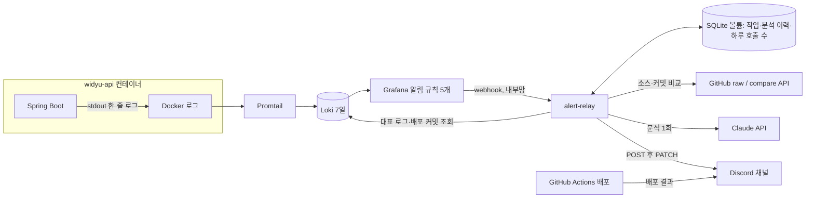
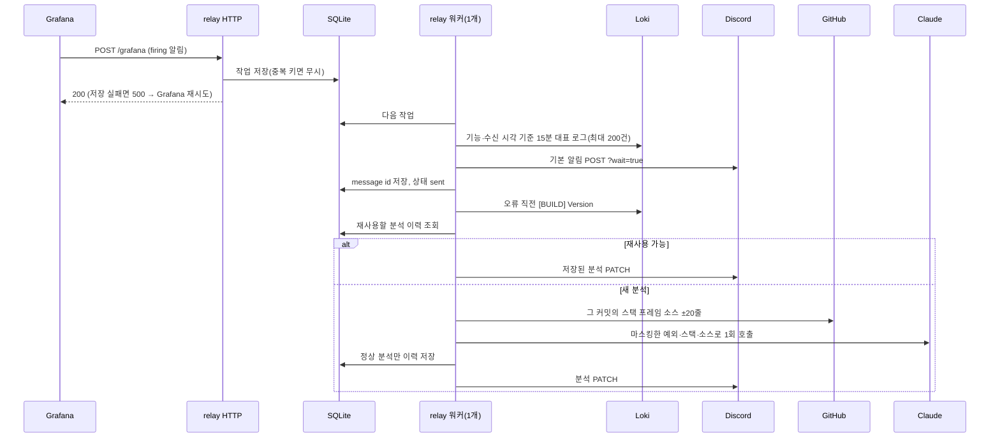
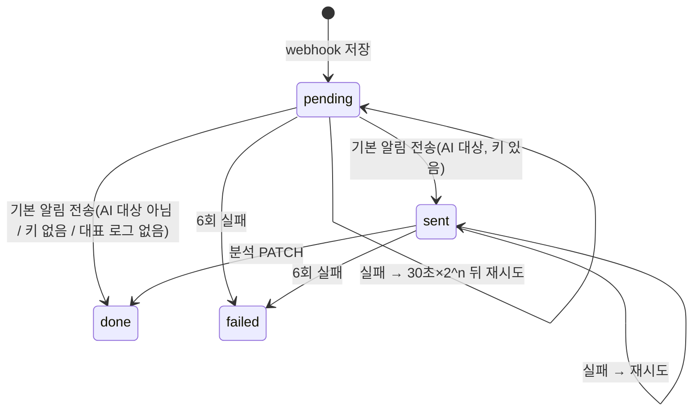
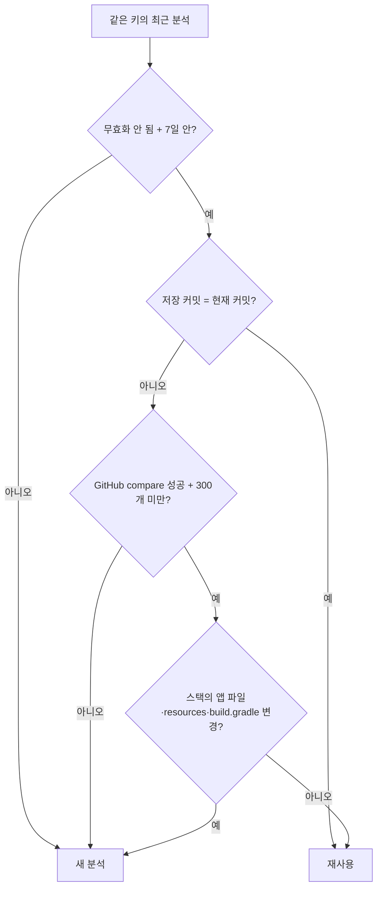

# Alerting Architecture

기준: 2026-10-12 / origin/develop `38ea59eb` + `feature/752` 변경(#752, 미병합). [기준과 갱신 규칙](README.md).

## 1. Overview

개발 서버에서 처리하지 못한 오류가 나면 Discord 메시지 하나를 받는다. 메시지 첫 줄에 실패한 기능 이름이 나오고, 그 아래에 엔드포인트, 요청한 회원과 대상, 예외가 이어진다. 수십 초 뒤 같은 메시지에 Claude의 원인 분석이 덧붙는다. 배포 성공·실패도 같은 채널로 알린다.

구조는 네 층이다.

1. 앱은 알림이 읽을 수 있는 **한 줄 로그**를 남긴다.
2. Grafana는 로그를 세어 **무엇이 실패했는지만** 판단한다.
3. 중계 서버(alert-relay)는 **상세 내용을 다시 조회해 메시지를 만들고 분석을 붙인다**.
4. 배포 알림은 GitHub Actions가 **따로** 보낸다.

설계 계약과 인수조건은 [LLD-0084](../lld/LLD-0084-discord-alert-ai-analysis.md)에 있다. 운영 명령은 [개발 서버 오류 관측](../operations/development-observability.md)에 있다.

## 2. Requirements

- 사람이 바로 조치해야 하는 실패만 알린다. 4xx, 입력 검증 실패, 해소 알림은 보내지 않는다.
- 같은 오류가 여러 번 나도 기능별 메시지 하나로 묶는다.
- AI 분석이 실패하거나 늦어도 기본 알림은 먼저, 반드시 간다.
- Discord에는 내부 회원 ID와 역할만 보낸다. AI에는 회원 ID, traceId, 실제 URI, 입력값을 보내지 않는다.
- 분석에 쓰는 소스는 오류가 난 시점에 배포돼 있던 커밋의 코드여야 한다.
- 중계 서버가 재시작되거나 Discord가 잠시 실패해도 알림을 잃지 않는다.

## 3. Architecture



| 구성 요소 | 위치 | 하는 일 |
| --- | --- | --- |
| 로그 맥락 | `global/log/ApiRequestContext`, `ExceptionLogEntry`, `StackTraceLog` | 5xx 예외에 기능 이름·경로 패턴·요청자·대상·원인 포함 스택을 한 줄로 남긴다 |
| 스케줄러 | `global/config/SchedulerConfig`, `SchedulerErrorHandler` | `@Scheduled`를 전용 `scheduling-N` 스레드에서 돌리고, 처리되지 않은 예외를 `[SCHEDULER]` 한 줄로 남긴다 |
| 푸시 | `fcm/application/FcmOutboxTransactions` | Outbox 행이 최종 실패로 바뀌는 순간 `[FCM_FAILED]`를 남긴다 |
| 배포 버전 | `global/log/BuildVersionLog` | 시작할 때와 매일 04:00에 `[BUILD] Version=<sha>`를 남긴다 |
| WebSocket | `global/websocket/WebSocketExceptionHandler` | `@MessageMapping` 서버 오류를 `[WS_EXCEPTION]` 한 줄로 남기고, 4xx 성격은 WARN으로 남긴다 |
| 알림 규칙 | `monitoring/grafana/provisioning/alerting/` | 규칙 5개, 연락처(webhook), 정책 |
| 중계 서버 | `monitoring/alert-relay/relay.py` | 작업 큐, 메시지 생성, 마스킹, AI 분석, 이력 |
| 배포 알림 | `scripts/ci/notify-discord-deploy.sh`, `deploy-dev.yml`, `deploy-prod.yml` | 배포 결과 전송 |

alert rule과 alert-relay는 `docker-compose.dev-server.yml`에만 있다. 그래서 로컬 `dev-up.sh`에서 난 오류는 Discord로 가지 않는다.

## 4. Log Contract

Grafana와 relay는 아래 형식에 의존한다. 로그 패턴(`application.yml`)은 `시각 레벨 traceId=<id|none> [스레드] 로거 - 메시지`다.

```text
[EXCEPTION] Time=.. Api=앨범 업로드 완료 Method=POST Path=/api/v1/albums/{albumId} Actor=USER#12 Target=albumId=7 ExceptionType=java.lang.IllegalStateException Message=.. RequestURI=.. StackTrace=a\nb\nCaused by: ..
[SCHEDULER] Task=PaymentRecoveryScheduler.recover ExceptionType=IllegalStateException Message=.. StackTrace=..
[WS_EXCEPTION] Api=HeartRateWebSocketController.sendHeartRate Destination=/app/heart-rate/send-single Actor=USER#34 ExceptionType=.. Message=.. StackTrace=..
[FCM_FAILED] Type=SAFE_ZONE_EXITED Emergency=true Related=34 Recipient=12 Attempts=4 Reason=INVALID_TOKEN
[BUILD] Version=38ea59eb7d4a460a00a4b4e7cd57a454d257d255
```

- **`Api`**: Swagger `@Operation(summary)`다. 없으면 `컨트롤러.메서드`, 핸들러가 정해지기 전에 실패하면 `알 수 없는 API`다.
- **`Path`**: 실제 URI가 아니라 매핑 패턴이다. 패턴이 없으면 `-`다. ID가 다른 같은 API를 한 알림으로 묶기 위해서다.
- **`Target`**: 이름이 `id`이거나 `Id`로 끝나는 경로 변수만 남긴다. 결제 키 같은 값은 넣지 않는다.
- **스택**: 원인까지 `\n`으로 이어 한 줄에 담는다. 여러 줄로 찍으면 Loki에 줄마다 따로 저장돼 traceId로 한 번에 찾을 수 없고, 다른 스레드 로그와 섞인다.

## 5. Alert Rules

| 규칙 | 줄 조건 | 알림 레이블(식별 정보) | Discord 제목 | AI 분석 |
| --- | --- | --- | --- | --- |
| DEV API 실패 | `[EXCEPTION]` | `api`, `method`, `path`, `exceptionType` | 🚨 기능 이름 실패 | O |
| DEV WebSocket 실패 | `[WS_EXCEPTION]` | `api`, `destination`, `exceptionType` | 🔌 WebSocket 실패 · 목적지 | O |
| DEV 스케줄러 실패 | ` ERROR traceId=none [scheduling-` | `task`, `logger`, `exceptionType` | ⏰ 스케줄러 실패 · 작업 | O |
| DEV 푸시 발송 실패 | `[FCM_FAILED]` | `type`, `emergency`, `reason` | 📵 푸시 알림 발송 실패 · 종류 | X |
| DEV 기타 ERROR | 위에 해당하지 않는 ERROR | `logger` | ⚠️ 에러 로그 · 로거 | O |

**5xx 응답은 예외 종류와 상관없이 API 실패다.** 응답이 5xx인 `BusinessException`(결제·파일 업로드·외부 연동 실패)도 `[EXCEPTION]`으로 남는다.

소셜 로그인·S3·SMS 코드는 `BusinessException`을 던지기 직전에 따로 ERROR를 남긴다. 그래서 같은 실패가 API 실패와 기타 ERROR로 두 번 잡힐 수 있다. relay는 기타 ERROR의 대표 로그에서 같은 traceId로 이미 `[EXCEPTION]`이 있는 줄을 빼고, 남는 줄이 없으면 기타 알림을 보내지 않는다. 요청 밖(비동기·리스너, traceId=none)의 ERROR는 그 로그가 유일한 기록이므로 그대로 알린다.

**레이블에는 요청마다 달라지는 값을 두지 않는다.** Grafana는 레이블 조합 하나를 알림 하나로 본다. traceId나 회원 ID를 레이블로 두면 요청마다 알림이 새로 생긴다. 이런 값은 relay가 Loki에서 다시 읽는다.

LogQL `regexp`는 패턴이 맞지 않는 줄을 거르지 않고 레이블만 비운다. 그래서 모든 규칙은 먼저 줄 필터로 형식을 맞추고, regexp 뒤에 `| <레이블> != ""`로 빈 레이블 줄을 버린다. provisioning 파일은 `$`를 환경변수로 치환하므로 템플릿 변수는 `$$`로 쓴다.

정책은 `group_by: ['...']`(레이블 조합 하나가 메시지 하나)다. 처음에는 30초를 모은 뒤 보내고, 같은 묶음이 바뀌면 5분 간격으로, 계속 실패 중이면 4시간마다 다시 보낸다. 해소 알림은 끈다(`disableResolveMessage`).

## 6. Relay Flow



작업 상태는 다음처럼 바뀐다.



워커는 하나다. 그래서 같은 오류가 동시에 들어와도 순서대로 처리된다. 두 번째 작업은 첫 분석을 재사용하고, Claude는 한 번만 호출된다.

## 7. AI Analysis and Reuse

**입력.** 마스킹한 예외 메시지·스택과, 오류 시점 배포 커밋의 앱 프레임 소스(최대 5개, ±20줄)를 보낸다. 마스킹은 개인정보와 요청마다 달라지는 값만 가린다.

| 가린다 | 남긴다 |
| --- | --- |
| 따옴표 입력값, 이메일, UUID, 7자리 이상 숫자 | HTTP 상태(401·503) |
| `*Id=숫자`, phone·token·password·name·session 값 | SQL 오류 코드(1062)·SQLState(23000) |
| | 제약조건·테이블·컬럼·인덱스 이름 |

요청자, 대상, traceId, 실제 URI는 AI 입력에 넣지 않는다. 배포 커밋을 찾지 못하거나 파일이 없으면 develop 소스로 대신하지 않는다. 대신 "소스 조회 실패"로 표시하고 스택 위치만으로 추정하게 한다.

**출력.** 답변 형식은 structured outputs(JSON 스키마)로 API 단에서 강제한다. relay는 스키마를 한 번 더 확인한 뒤 직접 그리므로 Discord에는 항상 같은 모양으로 나간다. 거절, 잘린 답변, 스키마 위반은 "분석 실패"로 처리하고 이력에 저장하지 않는다. 아래는 모양을 보여 주는 가상의 예시다.

```text
**원인 추정** · 신뢰도 보통
세션 TTL이 지난 뒤 완료 API가 호출되어 Redis 조회가 비었습니다.
**근거**
• `AlbumUploadSessionFacadeImpl.java:142` — 세션이 없으면 IllegalStateException을 던집니다.
**확인할 것**
• 클라이언트 재시도 간격
**수정 방향**
만료 세션은 4xx로 응답합니다.
```

**재사용.** 분석은 `ai_analyses`에 이력으로 계속 쌓이고, 지우지 않는다. 분석 키는 다음 값으로 만든다. 배포 커밋은 키에 넣지 않는다.

- 환경과 알림 종류
- 기능(API·작업·로거)과 예외 종류
- 메시지 형태: 6자리 이상 숫자를 지운 값
- 가장 안쪽 앱 프레임
- 프롬프트 버전



실패, 거절, 빈 답변은 이력에 저장하지 않는다. 잘못 저장된 분석은 `relay.py --invalidate <키 일부>`로 무효화한다. 하루 Claude 호출은 `ALERT_AI_DAILY_LIMIT`로 제한하고, 상한 조건을 UPDATE 안에 둬 재시작해도 넘지 않는다.

## 8. Deploy Notifications

| 워크플로 | 알리는 결과 | 실패 단계 표시 |
| --- | --- | --- |
| `deploy-dev.yml` (develop push) | 성공·실패. 새 push로 취소된 배포는 보내지 않는다 | 이미지 빌드 / 서버 배포 |
| `deploy-dev.yml` (매일 인증서 갱신) | 실패만 | — |
| `deploy-prod.yml` (수동 실행) | 성공·실패 | 테스트·빌드 / 이미지 빌드 / 서버 배포 |

`notify-discord-deploy.sh`는 커밋 제목, 짧은 SHA, 실행자, 소요 시간, 실행 링크를 보낸다. 알림이 실패해도 항상 0으로 끝나고 단계에 `continue-on-error`가 있어서, 배포 결과는 바뀌지 않는다. 배포 알림 webhook(`DISCORD_DEPLOY_WEBHOOK_URL`)은 에러 알림 webhook과 다른 것을 쓴다. 에러 알림 webhook은 GitHub에 두지 않는다.

## 9. Failure Handling

| 장애 | 동작 |
| --- | --- |
| relay 중단·재시작 | webhook 저장에 실패하면 500을 돌려 Grafana가 재시도한다. 저장된 작업은 재시작 뒤 이어서 처리한다 |
| Discord 실패 | 작업 단위 백오프로 재시도하고, 6회 실패하면 `failed`. Discord가 받았는데 응답만 시간 초과면 같은 메시지가 두 번 갈 수 있다(최소 한 번 전달) |
| Loki 조회 실패 | 작업 재시도. 대표 로그가 없으면 "상세 로그를 찾지 못했습니다"와 대시보드 링크를 보낸다 |
| Claude 실패·한도·거절 | 기본 알림은 그대로 두고 "분석 실패: 사유"를 덧붙인다. 작업 재시도로 넘기지 않아 호출 수를 다시 쓰지 않는다 |
| `ANTHROPIC_API_KEY` 없음 | 기본 알림만 보낸다 |
| 분석 이력 저장소 오류 | 재사용만 포기하고 분석과 알림은 계속한다 |
| 볼륨·디스크 손실 | 볼륨은 컨테이너 교체에는 남지만 디스크 손실은 막지 못한다. `--backup` 파일을 서버 밖에 보관한다 |

## 10. Operational Parameters

| 항목 | 값 | 설정 |
| --- | --- | --- |
| 규칙 평가 / 로그 창 | 1분 / 1분 | `alert-rules.yml` |
| 묶음 대기 / 변경 간격 / 반복 | 30초 / 5분 / 4시간 | `policies.yml` |
| 상세 로그 조회 | 알림 수신 시각 기준 15분, 최대 200건, 표시 3건 | `relay.py` |
| 배포 커밋 조회 범위 | 7일(Loki 보관 기간과 같음) | `relay.py` |
| Claude | `claude-opus-5`, effort medium, `max_tokens` 16000, 300초, JSON 스키마 강제 | `ALERT_AI_MODEL`, `relay.py` |
| 하루 호출 상한 / 재사용 기간 | 50회 / 7일 | `ALERT_AI_DAILY_LIMIT`, `ALERT_AI_REUSE_DAYS` |
| 작업 재시도 | 30초×2^n(최대 30분), 6회 | `relay.py` |

## 11. Trade-offs

- **중계 서버를 dev 서버 컨테이너로 둔 이유**: Grafana의 Discord 연동은 보낸 메시지를 수정하거나 분석을 붙일 수 없다. GitHub Actions에서 분석하면 public 저장소라 입력과 로그가 공개된다. 대신 컨테이너 하나와 SQLite 볼륨을 관리해야 한다.
- **AI를 도구 없이 1회만 호출하는 이유**: 비용과 프롬프트 주입 위험을 줄인다. 대신 Claude는 보낸 스택 프레임 근처의 코드만 보므로 분석은 추정이다. 메시지에도 확정 원인이 아니라고 표시한다.
- **분석 재사용 판단을 키가 아니라 커밋 비교로 하는 이유**: 배포마다 같은 에러를 다시 분석하지 않기 위해서다. `.env`처럼 저장소 밖에서 바뀌는 설정은 감지하지 못한다. 이때는 수동으로 무효화한다.
- **메시지를 오류마다가 아니라 묶음마다 보내는 이유**: 같은 기능의 오류 100건은 메시지 하나에 건수와 앞 3건만 보인다. 나머지는 Grafana 링크로 본다.

## 12. Related Decisions

- [LLD-0084](../lld/LLD-0084-discord-alert-ai-analysis.md): 이 구조의 구현 계약과 인수조건
- [LLD-0027](../lld/LLD-0027-development-error-observability.md), [ADR-0024](../adr/ADR-0024-development-observability-stack.md): traceId와 개발 관측 스택
- [Notification](notification.md): `[FCM_FAILED]`가 나오는 FCM Outbox 흐름
- [Infrastructure](infrastructure.md): 개발 서버 compose 구성
